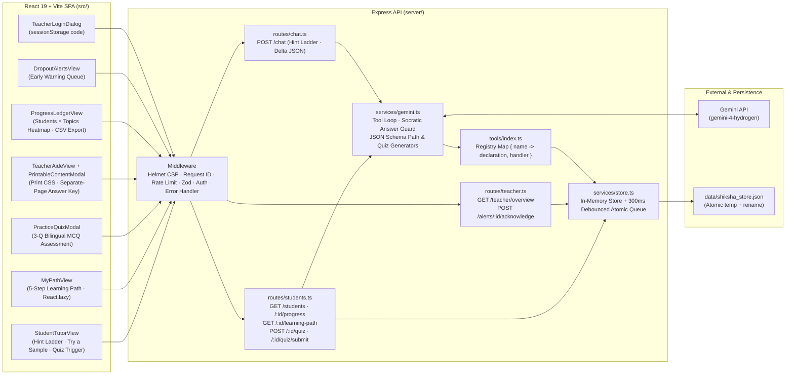

# Shiksha-Agent

An empathetic, bilingual AI teaching assistant and classroom teacher aide built for Indian state-board schools, aligned with the **AI for Education** track.

---

## Problem Statement

Teachers in Indian state-board classrooms frequently manage 40–60 students across diverse regional languages (Hindi, Tamil, Marathi, Gujarati, Hinglish, and English) with limited time for individualized remediation or early dropout intervention. Meanwhile, students studying at home often lack patient, step-by-step guidance—either receiving no help or copying direct answers without building foundational mastery.

**Shiksha-Agent** bridges this gap with a dual-mode AI workspace:

- **Student Tutor & My Path (Public Student Workspace):** Responds in the student's own language via a clean WhatsApp-inspired flow, uses local Indian analogies (rotis, mangoes, cricket, local markets), accepts handwritten notebook photos, enforces Socratic guidance with a server-side answer guard and 3-level Hint Ladder, unlocks a 5-step Personalised Learning Path as topics reach Mastery, and assesses mastery with 3-question bilingual Practice Quizzes.
- **Teacher Aide, Class Heatmap & Early Warning Console (Protected Teacher Workspace):** Helps teachers generate structured, time-boxed lesson plans and printable bilingual worksheets (with separate-page Answer Keys), inspect a Students × Topics Class Mastery Heatmap with CSV export, and respond to real-time dropout-risk alerts.

---

## Features Mapped to the 5 AI-for-Education Pillars

| AI-for-Education Pillar                | Shiksha-Agent Feature & Implementation                                                                                                                                                                                                                                                                                                                                                                                                                                                                                                                                            |
| -------------------------------------- | --------------------------------------------------------------------------------------------------------------------------------------------------------------------------------------------------------------------------------------------------------------------------------------------------------------------------------------------------------------------------------------------------------------------------------------------------------------------------------------------------------------------------------------------------------------------------------- |
| **1. Personalised Learning Paths**     | **My Path (`MyPathView`, `GET /api/students/:id/learning-path`)**: Generates a 5-step personalised study path (topic, rationale, estimated minutes, status) via Gemini structured JSON schema (`responseSchema`). Steps unlock sequentially as topics reach `Mastered`, and the path automatically regenerates after each new progress log.                                                                                                                                                                                                                                       |
| **2. AI Teaching Assistant**           | **Student Tutor & Teacher Aide (`StudentTutorView`, `TeacherAideView`, `POST /api/chat`)**: Bilingual Socratic tutor using local Indian examples, a **3-level "I'm stuck" Hint Ladder** (Level 1 guiding question → Level 2 similar worked example with different numbers → Level 3 first step only, logging `hints_used`), and a **server-side Socratic Answer Guard** that detects leaked numeric answers and regenerates once.                                                                                                                                                 |
| **3. Interactive Learning**            | **Multimodal Homework & Syllabus Analysis (`StudentTutorView`, `TeacherAideView`)**: Client-side canvas image compression (1280px, JPEG 0.8), one-click **"Try a sample"** homework/syllabus photos, live-region WhatsApp-style conversation with per-message script `lang` detection (`hi`, `mr`, `ta`, `gu`, `en`), and direct Tutor hand-off from unlocked My Path steps.                                                                                                                                                                                                      |
| **4. Student Engagement & Assessment** | **Mastery Practice Quizzes, Progress Ledger & Class Heatmap (`PracticeQuizModal`, `ProgressLedgerView`, `DropoutAlertsView`)**: Automatically logs topic competency & `hints_used` via `log_student_progress`, offers **3-question bilingual MCQ Practice Quizzes** (`POST /api/students/:id/quiz` & `/quiz/submit` via JSON schema) after Mastery with score + explanations logged back to progress, triggers `alert_teacher_dropout_risk` on frustration, and renders a **Teacher Class Heatmap (Students × Topics)** with color + text badges and formula-safe **CSV export**. |
| **5. Smart Content Creation**          | **Printable Lesson Plans & Bilingual Worksheets (`TeacherAideView`, `PrintableContentModal`, `@media print`)**: Generates structured 40-minute lesson plans, bilingual worksheets, and syllabus-photo diagnostics, with one-click **Print / Export Sheet** formatting that automatically places the **Answer Key on a separate printed page**.                                                                                                                                                                                                                                    |

---

## Architecture



### Module Layout

- `shared/` — Shared client/server code: `config.ts`, `types.ts`, `schemas.ts`, `sessionStore.ts`, `security.ts`, `prompts.ts`, `seedData.ts`, `shikshaLogic.ts`, `socraticGuard.ts`, `educationLogic.ts`.
- `server/index.ts` — Express bootstrap, Helmet CSP, Vite dev middleware / `dist` static serving, graceful shutdown flush.
- `server/middleware/` — `requestId.ts`, `auth.ts`, `studentSession.ts`, `validation.ts`, `rateLimit.ts`, `errorHandler.ts`.
- `server/routes/` — `students.ts` (roster, session creation, progress, learning path, quizzes), `teacher.ts` (overview, alerts, weekly summary, parent updates, student data deletion), `chat.ts` (tutor + teacher chat).
- `server/services/` — `geminiClient.ts`, `chatLoop.ts`, `answerGuard.ts`, `learningPath.ts`, `quizGenerator.ts`, `teacherGenerators.ts`, and `store.ts` (in-memory store with debounced serialized atomic writes).
- `server/tools/` — Registry map (`index.ts`, `types.ts`) with one file per tool (`logStudentProgress.ts` with `hints_used`, `alertTeacherDropoutRisk.ts`).
- `src/` — React 19 SPA with modular feature directories (`components/landing/`, `components/tutor/`, `components/teacher/`, `components/progress/`, `hooks/`, `routing.ts`, `utils/`).

---

## Setup Steps

### Prerequisites

- Node.js 22+
- npm 10+

### Local Development

1. Install dependencies:
   ```bash
   npm install
   ```
2. Copy `.env.example` to `.env` and populate your secrets:
   ```bash
   cp .env.example .env
   ```
3. Start the full-stack development server (Express + Vite middleware on port `3000`):
   ```bash
   npm run dev
   ```
4. Open `http://localhost:3000`.

### Production Build & Start

```bash
npm run build
NODE_ENV=production npm start
```

- `npm run build:client` compiles the Vite SPA (with lazy-loaded chunks for My Path, Teacher Aide, Progress Ledger & Heatmap, and Dropout Alerts) into `dist/`.
- `npm run build:server` bundles `server/index.ts` via `esbuild` into `dist/server.js`.
- `npm start` runs `node dist/server.js`.

---

## Environment Variables

| Variable              | Required               | Scope       | Description                                                                                                                                                |
| --------------------- | ---------------------- | ----------- | ---------------------------------------------------------------------------------------------------------------------------------------------------------- |
| `GEMINI_API_KEY`      | Yes                    | Server only | Google Gemini API key read exclusively by `server/services/geminiClient.ts`. Never exposed to client bundles.                                              |
| `TEACHER_ACCESS_CODE` | Yes (for teacher tabs) | Server only | Shared secret verified in constant time against the `x-teacher-code` header for Teacher Aide, Progress Heatmap, Dropout Alerts, and alert acknowledgement. |
| `SESSION_HMAC_SECRET` | Optional               | Server only | HMAC-SHA256 key (>= 16 chars) for signing chat session IDs. Auto-generated per boot if omitted.                                                            |
| `PORT`                | Optional               | Server only | HTTP port to bind (defaults to `3000`).                                                                                                                    |
| `NODE_ENV`            | Optional               | Server only | Set to `production` to serve prebuilt static assets from `dist/` and enable strict production CSP.                                                         |
| `APP_URL`             | Optional               | Runtime     | Public hosting URL (injected automatically in Cloud Run / AI Studio deployments).                                                                          |

---

## Security Measures

1. **Strict Input Validation (`zod`):** Every API route validates parameters and bodies. `/api/chat` enforces `mode` (`student` | `teacher`), max 20 messages, max 2,000 chars per message, strict role enum, optional `hintLevel` (1–3), allowlisted image MIME types (`image/jpeg`, `image/png`, `image/webp`), decoded image size <= 4 MB, and Express JSON body limit of `5mb`.
2. **Student-Bound HMAC Sessions & Anti-Spoofing Chat History:** Every student chat session is bound to its `studentId` on creation (`POST /api/students/:id/session` or first `/api/chat`). Requests using a `sessionId` bound to a different student are rejected with `403`, and `/api/students/:id/progress`, `/learning-path`, `/quiz`, and `/quiz/submit` require a valid `x-student-session` header bound to that same student. Client-supplied `assistant` messages are accepted only if previously issued by the server for that session.
3. **Role-Based Access Control (RBAC):** Student Tutor and My Path work via student-bound sessions without a password. Teacher Aide, Progress Ledger & Heatmap, Dropout Alerts, Parent Updates, Weekly Summary, Student Data Deletion, and `/api/alerts/:id/acknowledge` require a valid `x-teacher-code` header verified using SHA-256 + `crypto.timingSafeEqual`.
4. **Zero Real PII Exposure & Fictional Seed Numbers:** `whatsappNumber` is completely omitted from all public student API payloads; teacher payloads expose only a masked suffix (`******1204`). All seed phone numbers use clearly fictional invalid numbers (`+91 00000 01204`, etc.), and `data/` is gitignored so `data/shiksha_store.json` is generated from seed on first boot only.
5. **Server-Enforced Tool Identity & Quiz Grading:** Tool handlers ignore model-supplied `student_id` arguments and bind records strictly to the server-verified active student ID. Practice Quiz answer keys remain server-side until submission.
6. **Rate Limiting, Headers & CSV Formula Safety:** `express-rate-limit` caps `/api/chat` at 20 req/min/IP and other `/api/*` routes at 60 req/min/IP. `helmet` enforces CSP; heatmap CSV export neutralizes spreadsheet formula injection (`=`, `+`, `-`, `@`).
7. **Safe Error Handling & Prompt-Injection Defence:** Full errors are logged server-side with `X-Request-Id`; clients receive generic messages + `requestId`. System prompts treat user text and image OCR strictly as untrusted data.

---

## Threat Model & Known Limitations

- **Open Demo Student Picker (By Design):** In this hackathon/demo deployment, anyone visiting `/app` can switch between the four sample student profiles and mint a student-bound session for that profile. Once minted, that session cannot read or mutate another student's endpoints (`403`), but the initial profile selection is intentionally unauthenticated for frictionless judging. **Production path:** authenticate students via WhatsApp OTP (or school-issued SSO) before issuing the student-bound session token.
- **Single-Node JSON File Persistence:** Runtime state is stored in an in-memory cache flushed atomically to `data/shiksha_store.json` (gitignored and created from seed on first boot). This supports single-instance deployments without external infrastructure, but does not horizontally scale across multiple replicas or survive ephemeral container restarts without a persistent volume. **Production path:** replace `StoreManager` with a managed database (e.g., Cloud SQL PostgreSQL or Firestore) with row-level security and automated backups.
- **In-Memory Sessions & Rate Limiters:** HMAC-signed chat sessions and per-IP rate-limit counters live in process memory and reset on server restart. **Production path:** store sessions and rate-limit buckets in Redis / Memorystore.
- **Secrets Management:** `GEMINI_API_KEY`, `TEACHER_ACCESS_CODE`, and `SESSION_HMAC_SECRET` live exclusively in AI Studio Secrets / server environment variables, are never committed to source control, and are never bundled into client assets.

---

## Accessibility Measures (WCAG 2.2 AA)

- **Live Regions & Multilingual Pronunciation:** `role="log" aria-live="polite"` on chat feeds, `role="status"` announcing `"Shiksha is thinking…"`, `<html lang="en">`, and automatic script-based `lang` attributes (`hi`, `mr`, `ta`, `gu`, `en`) on chat messages and quiz items.
- **Landmarks, Skip Link & Heading Order:** Keyboard-visible `"Skip to main content"` link targeting `<main id="main-content" tabIndex={-1}>`, strictly one `<h1>` per view with sequential heading levels, and `aria-current="page"` on active navigation tabs.
- **Non-Color Indicators & Semantic Markdown:** Competency badges, learning-path statuses, and heatmap cells always combine icons with text labels; Markdown bullet/numbered lists render as real `<ul>`/`<ol>`/`<li>`; filter chips and text-size buttons expose `aria-pressed`.
- **Keyboard Focus Management:** Global high-contrast `:focus-visible` outlines, input focus restoration after sending messages, and Tab/Shift+Tab focus traps with `Escape` dismissal and opener focus restoration across all modals (`TeacherLoginDialog`, `PracticeQuizModal`, `PrintableContentModal`, `ParentUpdateModal`, `DeleteStudentDataDialog`).
- **Contrast, Touch Targets, Reduced Motion & Low-Vision Scaling:** Automated 4.5:1 contrast verification across all Light, Night, and Landing hero stat-chip color pairs, minimum `44×44px` touch targets, `prefers-reduced-motion` support, responsive reflow from 320px to 1440px+ and 200% zoom, and a persisted `A / A+ / A++` top-bar text-size control.

---

## Running Tests, Linting & Formatting

```bash
# Run full Vitest suite (API, store, security, education logic, React components, axe)
npm test

# Run tests with V8 coverage report (enforces lines >= 80%, functions >= 80%, branches >= 75%, statements >= 80%)
npm run test:coverage

# Type-check client and server TypeScript without emitting files
npm run typecheck

# Run ESLint (typescript-eslint, react-hooks, jsx-a11y) with zero warnings allowed
npm run lint

# Format all supported files with Prettier
npm run format
```
